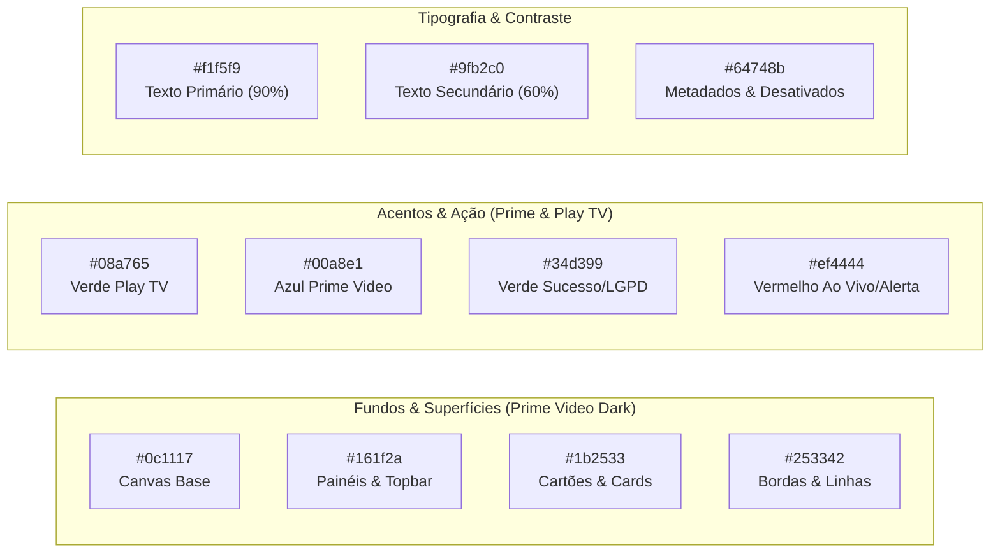

# Play TV — Especificação de Design e Sistema Visual (DESIGN.md)
*Referência Estética: Amazon Prime Video (sem alterar o layout funcional do Play TV)*
*Tela de Referência Aprovada no Piloto: `index.html`*

---

## 1. Filosofia de Design e Conceito Visual

O design do **Play TV** adota a atmosfera cinemática, sóbria e imersiva inspirada na interface do **Amazon Prime Video**, preservando integralmente o layout atual, a rapidez de navegação e a disposição dos componentes do player.

O objetivo é transformar a experiência de assistir televisão na web em algo premium, onde a interface atua como uma moldura discreta para o conteúdo audiovisual:
- **Imersão Noturna (Canvas Escuro):** O fundo usa superfícies neutras sem gradientes decorativos (`--canvas`, `--surface` e `--elevated`).
- **Foco no Conteúdo:** Logos de canais e thumbnails de transmissões ganham destaque vibrante através de contraste óptico com as superfícies escuras.
- **Micro-interações Sutis:** Efeitos de elevação suave ao passar o mouse ou mover o foco do controle remoto (D-Pad).
- **Consistência "10-foot UI":** Elementos de foco, tipografia e espaçamentos calibrados para serem visualizados com conforto a 3 metros de distância na Smart TV ou na palma da mão no smartphone.

---

## 2. Tokens de Design (Design Tokens)

### 2.1. Paleta de Cores (Color Palette)



| Token | Valor Hex / RGBA | Uso na Interface |
| :--- | :--- | :--- |
| `--bg-base` | `#0c1117` | Fundo principal da aplicação |
| `--bg-surface` | `#161f2a` | Painel hero, destaques e cabeçalho |
| `--bg-card` | `#1b2533` | Fundo dos cartões de canal |
| `--border-subtle` | `rgba(255, 255, 255, 0.08)` | Divisórias e bordas de cards |
| `--accent-green` | `#08a765` | Botões primários, badges de destaque |
| `--accent-blue` | `#00a8e1` | Referência Prime Video, links e tags especiais |
| `--text-primary` | `#f1f5f9` | Títulos de canais, cabeçalhos, textos principais |
| `--text-muted` | `#8da2b5` | Categorias, metadados, contadores de canais |
| `--focus-ring` | `rgba(8, 167, 101, 0.75)` | Anel de foco para Smart TV e acessibilidade |

---

### 2.2. Tipografia e Escala de Tipos
A interface utiliza tipografia do sistema nativa (Apple SF Pro, Segoe UI, Roboto, Ubuntu), garantindo zero tempo de download de fontes e renderização perfeita em qualquer dispositivo.

- **Display / Hero Title:** `20px` a `24px` — Peso 700 (Bold) — *Integração Shopee / Canal em Direto*
- **Títulos de Seção:** `14px` a `16px` — Peso 600 (Semibold) — *Recentes, Favoritos, Todos os Canais*
- **Nomes de Canais (Cards):** `13px` — Peso 600 — *Globo SP, ESPN, CNN Brasil*
- **Subtítulos e Categorias:** `11px` a `12px` — Peso 400 — *Notícias · Brasil*
- **Badges e Tags:** `10px` a `11px` — Peso 700 (Uppercase/SmallCaps) — *AO VIVO, HD, LGPD*

---

### 2.3. Espaçamentos e Geometria
- **Dimensões e Proporções dos Cartões do Carrossel (Original Play TV):**
  - **Desktop / TV:** `220px` de largura por `220px` de altura (`min-height: 220px; height: 220px; grid-auto-columns: 220px`), organizados em **2 linhas horizontais** com fluxo por coluna (`grid-template-rows: repeat(2, auto); grid-auto-flow: column`).
  - **Mobile (< 700px):** `180px` de largura por `180px` de altura (`min-height: 180px; height: 180px; grid-auto-columns: 180px`).
  - **Grade do Modal "Todos os Canais":** Grid vertical adaptativo `minmax(220px, 1fr)`.
- **Cantos Arredondados (Border Radius):**
  - Cartões de Canal: `12px` (original do Play TV)
  - Painéis Principais (Hero & Favoritos): `10px`
  - Botões de Ação e Abas: `6px`
  - Modais: `12px`
  - Badges (Pills): `999px`
- **Sombras e Elevação (Elevation):**
  - As superfícies não usam sombra decorativa.
  - A hierarquia vem de fundo, divisor de 1px, tamanho e peso.
  - O foco usa contorno visível sem brilho ou sombra.

---

## 3. Padrões de Componentes (Component Architecture)

### 3.1. Hero Banner e Mini-Player em Direto (Estilo Prime Video)
O painel superior "Recentes" reproduz o padrão dos banners de destaque do Prime Video:
- **Telinha de Vídeo Silenciada:** Exibe o canal em movimento suave no fundo da área de destaque sem travar a navegação.
- **Logotipo do Canal Limpo:** Logo em formato PNG transparente posicionado no canto inferior direito, com filtro `drop-shadow(0 2px 6px rgba(0, 0, 0, 0.8))` e sem plaquinhas sólidas cortando a imagem.
- **Copywriting:** Título grande, tag de lançamento ou destaque em verde acentuado e sinopse em texto cinza-azulado.
- **Controles de Carrossel:** Setas circulares discretas nas laterais com efeito hover iluminado e pontos de paginação (*dots*) minimalistas na base.

```
+---------------------------------------------------------------------------------+
|  Play TV                  [BR Brasil v]  [Escudo LGPD]  [Menu]  [Fontes IPTV]   |
+---------------------------------------------------------------------------------+
|  [Recentes - Mini Player em Direto]        |  [Favoritos - Grid Rápido]         |
|  EM DIRETO                                 |  [Logo 1] Canal A   [Logo 2] Canal B|
|  Globo SP HD                               |  [Logo 3] Canal C   [Logo 4] Canal D|
|  Transmissão ao vivo em sinal aberto       |                                    |
|  ( < )  ( o  o  o )  ( > )      [LOGO PNG] |                                    |
+---------------------------------------------------------------------------------+
```

---

### 3.2. Trilhos Horizontais de Conteúdo ("Rails" / Carrossel em 2 Linhas)
A seção de catálogo preserva exatamente a arquitetura de carrossel original do Play TV:
- **Header do Trilho:** Nome da categoria com ícone SVG sutil e botão interativo com contador discreto de canais disponíveis (ex: `📺 Brasil (84)`), que abre o modal completo de busca.
- **Scroll Nativo Suave:** Rolagem horizontal contínua com suporte a toque (swipe) em smartphones e setas laterais (.car-arrow) com pontos (.car-dots).
- **Cartão de Canal (App Card - Original Play TV):**
  - **Formato Quadrado Original:** `220px x 220px` (min-height e height 220px) no desktop, preservando o layout clássico com botão "Assistir" integrado na base.
  - **Grid de 2 Linhas:** `grid-template-rows: repeat(2, auto)` e `grid-auto-columns: 220px`, permitindo navegar por dois canais simultaneamente por coluna de rolagem.
  - **Visual do Card:** Ícone de estrela flutuante no canto superior direito para favoritar rapidamente (`.badges`), logo do canal centralizado e redimensionado proporcionalmente com fundo escurecido contrastante (`#1b2531`) e borda sutil (`#31404f`).
  - **Rodapé do Cartão:** Nome do canal legível e categoria, com botão "Assistir" de largura total ocupando a base inferior.

---

### 3.3. Barra Superior (Topbar) e Ações Rápidas
- **Branding:** Logo Play TV em tom branco brilhante com ícone de televisão estilizado.
- **Seletor de País:** Botão compacto com bandeira em alta resolução (CDN FlagCDN), nome do país e seta expansível. Em telas de celular, oculta o texto mantendo apenas a bandeira para preservar o espaço dos botões.
- **Botões de Ícones:** Botões quadrados de toque generoso (mínimo de 44x44px em celular para conformidade com Apple HIG e Google Material):
  - Botão de Escudo de Proteção (Termos de Uso e Privacidade LGPD);
  - Botão de Menu com atalhos de ajustes e fontes;
  - Botão de Fontes IPTV (gerenciador de listas M3U).

---

### 3.4. Modal do Player e Controles de Transmissão
Inspirado na experiência de reprodução do Prime Video:
- **Backdrop:** Escurecimento quase total da tela (`rgba(4, 8, 13, 0.88)` com desfoque de fundo) para concentrar 100% da atenção do usuário no vídeo.
- **Controles Sobrepostos (HUD):**
  - Barra inferior em degradê preto translúcido que desaparece automaticamente após inatividade.
  - Indicador do nome do canal e bandeira no topo.
  - Botões de navegação rápida: *Canal Anterior*, *Pausar/Play*, *Próximo Canal*, *Alternar Fonte*, *Favoritar* e *Tela Cheia*.
- **Em Smart TV:** Abertura automática em tela cheia ocupando 100vw x 100vh, com HUD temporário que se recolhe após 3 segundos de reprodução.

---

### 3.5. Modais de Conteúdo (Termos de Uso, Configurações e Fontes)
- **Termos — Referência visual:** Inspirado no Amazon Prime Video, usa exclusivamente tema escuro, sem brilho ou sombra decorativa e sem cards dentro do modal. As seções permanecem planas e separadas por divisores.
- **Termos — Destaques:** Azul é a única cor decorativa; o ícone e os badges são monocromáticos. Não usar verde ou roxo nos badges.
- **Termos — Leitura e rolagem:** Texto jurídico legível em desktop e celular; o corpo do conteúdo rola dentro do modal limitado à altura da tela, começa no topo e não causa rolagem horizontal na página.
- **Referência aprovada:** `app.js` (`openTermsModal`) e `styles.css` (`.modal.terms-modal`).
- **Scrollbar Personalizada:** Barra de rolagem fina (6px) em tom escuro (`#31404f`) que não polui visualmente a leitura.

---

## 4. Diretrizes de Responsividade e Formatos de Tela

| Formato de Tela | Largura | Comportamento Visual |
| :--- | :--- | :--- |
| **Mobile Portrait (Celular)** | `< 600px` | Coluna única, hero redimensionado, botões com mínimo de 44px de toque, texto do país ocultado. |
| **Tablet / Foldables** | `600px - 1024px` | Grade de 2 a 3 colunas, painéis lado a lado adaptativos, toque otimizado. |
| **Desktop / Laptop** | `1024px - 1920px` | Painéis duplos superiores (Hero 60% / Favoritos 40%), catálogo em trilhos de 5 a 6 colunas. |
| **Smart TV / 10-foot UI** | `1080p / 4K` | Contorno de foco de 3px com cor semântica (`var(--primary)`), escala de 1.04 no foco, player em tela cheia nativa. |
