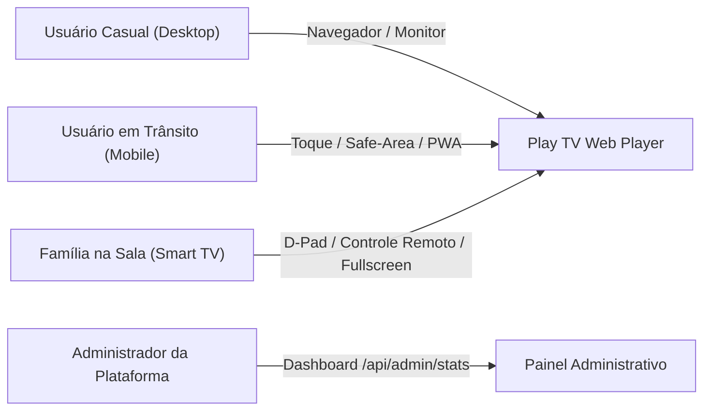

# Play TV — Documento de Visão de Produto (PRODUCT.md)

## 1. Visão Geral e Proposta de Valor

O **Play TV** é um reprodutor multimídia e agregador web de transmissões abertas de televisão (IPTV) focado em **alta velocidade, leveza, estabilidade e experiência cinemática**. A aplicação é 100% baseada na web (sem necessidade de instalação de aplicativos externos) e projetada para funcionar de maneira responsiva e fluida em **computadores desktop, smartphones, tablets e Smart TVs (10-foot UI)**.

A plataforma resolve a dor do usuário comum que busca acesso direto a canais abertos, notícias, esportes e entretenimento sem burocracia, cadastros invasivos ou players lentos e pesados.

---

## 2. Pilares do Produto

1. **Acesso Imediato e Descomplicado:** Zero barreiras de entrada. O usuário acessa a URL e pode assistir instantaneamente ao catálogo de canais.
2. **Experiência Universal (Multi-Dispositivo):** Interface que se adapta perfeitamente ao toque no smartphone, ao mouse/teclado no desktop e ao controle remoto direcional (D-Pad) na Smart TV.
3. **Privacidade por Padrão (Privacy-by-Design & LGPD):** Sem coleta de dados pessoais, sem rastreadores comportamentais entre sites (*cross-site tracking*), com armazenamento de preferências restrito ao dispositivo do usuário (`localStorage`).
4. **Resguardo Jurídico e Mero Indexador:** A plataforma **não hospeda nem retransmite canais**. Atua exclusivamente como organizadora e reprodutora de links abertos e públicos da internet (projeto mundial colaborativo *iptv-org*).
5. **Monetização Sustentável e Não Intrusiva:** Exibição de anúncios pre-roll breves com opção de pular após 5 segundos, com frequência balanceada (a cada 3 trocas de canal) para custear a infraestrutura sem prejudicar o usuário.

---

## 3. Personas e Cenários de Uso

### Persona 1: O Espectador de Sala de Estar (Smart TV)
- **Cenário:** Família reunida na sala utilizando uma TV Samsung (Tizen), LG (webOS) ou TV Box com Android TV.
- **Necessidades:** Navegação rápida através de botões direcionais do controle remoto (Cima, Baixo, Esquerda, Direita, OK e Voltar), cartões grandes legíveis a 3 metros de distância e player que abre em tela cheia automaticamente com comandos de trocar canal (Ch+/Ch-).

### Persona 2: O Usuário Mobile (Smartphone / Tablet)
- **Cenário:** Usuário no transporte público, viagem ou intervalo do trabalho assistindo notícias ou eventos esportivos pelo celular.
- **Necessidades:** Carregamento ultrarrápido em redes móveis (4G/5G), respeito à área segura do notch do celular (`viewport-fit=cover`), controles de toque amplos e mini-player que não trava a rolagem.

### Persona 3: O Usuário de Computador (Desktop)
- **Cenário:** Profissional que deixa o canal de notícias sintonizado em uma aba secundária ou monitor lateral enquanto trabalha.
- **Necessidades:** Atalhos de teclado intuitivos (Barra de Espaço para pausar, 'F' para tela cheia, 'M' para mudo), busca instantânea e alternância rápida de abas de categorias.

---

## 4. Funcionalidades Principais (Core Features)

### 4.1. Catálogo e Organização de Canais
- **Seleção Dinâmica de Países:** Filtro com bandeiras de mais de 50 países do mundo, com foco especial no Brasil (`BR`), Portugal (`PT`) e feeds internacionais abertos.
- **Categorização Automática:** Separação em abas temáticas: *Notícias*, *Esportes*, *Geral*, *Música*, *Infantil*, *Documentários*, *Filmes* e *Canais Abertos*.
- **Busca em Tempo Real:** Filtro textual instantâneo no topo com suporte a digitação no teclado e busca virtual.
- **Favoritos com Persistência Local:** O usuário pode marcar seus canais prediletos com estrela; os favoritos aparecem no grid superior com acesso em 1 clique e ficam salvos permanentemente no navegador.

### 4.2. Player de Vídeo HLS
- **Reprodução HTTP Live Streaming (HLS):** Suporte a playlists `.m3u8` e fragmentos `.ts`/`.m4s` via engine Hls.js com recuperação automática de buffer e erros de rede.
- **Mini-Player em Direto (Carrossel Superior):** Telinha de preview com áudio silenciado que exibe o último canal visitado em tempo real sem travar a navegação.
- **Multi-Fontes por Canal:** Botão "Próxima Fonte" para alternar para links alternativos caso um fluxo upstream sofra instabilidade.

### 4.3. Monetização e Anúncios (HilltopAds)
- **Pre-Roll Não Intrusivo:** Anúncio exibido ao iniciar o primeiro canal e recarregado a cada 3 canais trocados.
- **Botão "Pular Anúncio":** Contagem regressiva transparente de 5 segundos liberando o botão para o usuário fechar o anúncio e continuar assistindo.
- **Failsafe / Timeout de Segurança:** Se a rede de anúncios falhar em responder em até 8 segundos, o player inicia o canal automaticamente, garantindo que o usuário nunca fique travado.

### 4.4. Segurança, Anti-Abuso e Proteção Jurídica
- **Termos de Uso e Política de Privacidade LGPD:** Modal acessível no cabeçalho detalhando a conformidade com a Lei Federal nº 13.709/2018 e Marco Civil da Internet (Lei nº 12.965/2014).
- **Proteção Anti-Bot & Anti-Scraper:** Bloqueio automático na borda de scrapers e scanners que tentam esgotar recursos de rede.
- **Anti-Hotlinking:** Impede que sites terceiros usem o proxy do Play TV como CDN gratuita de streams.
- **Anti-Iframe / Clickjacking:** Cabeçalhos `X-Frame-Options: SAMEORIGIN` e `CSP` que bloqueiam incorporações não autorizadas.
- **Honeypot na Tela de Bloqueio:** Campo oculto que descarta automaticamente tentativas de login submetidas por bots de spam.

### 4.5. Painel Administrativo em Tempo Real (`admin.html`)
- **Autenticação Segura:** Login protegido com emissão de token criptográfico assinado via HMAC-SHA256 e expiração automática de 12 horas.
- **Métricas e KPIs:** Dispositivos ativos em tempo real, pico de audiência nas últimas 24 horas, gráfico horário e canais mais sintonizados.
- **Gestão Remota de Anúncios:** Painel para ativar/desativar publicidade, ajustar frequência de canais e configurar URLs de tags VAST e links diretos da HilltopAds sem precisar de novo deploy.

---

## 5. Roadmap e Evoluções Futuras

| Fase | Funcionalidade | Descrição |
| :---: | :--- | :--- |
| **v1.0 (Atual)** | Core Player + Mobile/TV + Ads + Segurança | Versão estável com player HLS, D-Pad, LGPD, Anti-Bot e Painel Admin. |
| **v1.1** | EPG (Guia Eletrônico de Programação) | Exibição da programação do canal em tempo real ("O que está passando agora"). |
| **v1.2** | Modo Escuro/Claro e Temas Personalizados | Suporte a temas personalizados além da paleta cinemática noturna padrão. |
| **v1.3** | Filtro Parental / Modo Kids | Opção de travar canais adultos ou de conteúdo sensível via PIN local de 4 dígitos. |
| **v2.0** | PWA Offline Shell & Cache Avançado | Instalação como App Web Progressivo no Android e iOS com tela cheia nativa. |
