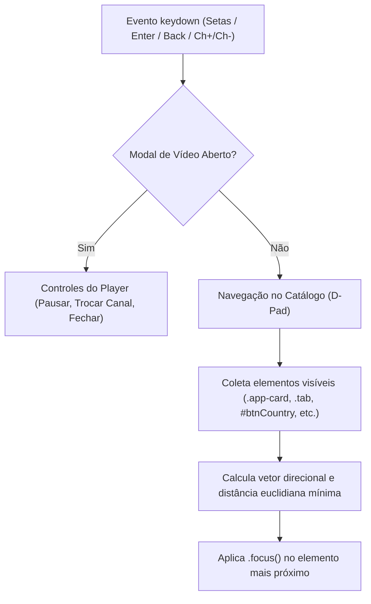

# Play TV — Especificação Técnica de Engenharia (SPEC.md)

## 1. Arquitetura do Sistema e Stack Tecnológico

A arquitetura do **Play TV** foi projetada para ter **zero dependências pesadas de runtime**, atingindo tempos de carregamento inferiores a 1 segundo e compatibilidade universal com qualquer navegador web moderno, TV Box ou Smart TV.

```mermaid
graph TD
    Client["Cliente Web (Navegador Desktop / Mobile / Smart TV)"]
    HLS["Engine Hls.js (CDN v1)"]
    Cloudflare["Borda Cloudflare Pages (play-tv.pages.dev)"]
    Worker["Cloudflare Functions V8 Runtime (functions/[[path]].js)"]
    InternalCache["Cloudflare Cache API (playtv-internal.cache/state)"]
    ExternalM3U["Repositórios IPTV Públicos (iptv-org / GitHub)"]
    ExternalHLS["Servidores de Stream Originários (m3u8 / ts / m4s)"]

    Client -->|Carrega Assets Estáticos (HTML/CSS/JS)| Cloudflare
    Client -->|Reproduz Streams HLS| HLS
    HLS -->|Requisições de Segmentos e Playlists| Worker
    Worker -->|Verifica Sessões e Métricas| InternalCache
    Worker -->|Busca Playlists M3U| ExternalM3U
    Worker -->|Proxy e Reescrita de Streams| ExternalHLS
```

### Tecnologias Utilizadas:
- **Frontend:** HTML5 Semântico, CSS3 Moderno (CSS Custom Properties, Flexbox, CSS Grid), JavaScript Vanilla (ES2022+).
- **Player HLS:** Hls.js (v1.x via jsDelivr CDN com fallback nativo para navegadores Safari iOS/macOS).
- **Backend / Edge Functions:** Cloudflare Pages Functions (V8 Worker Runtime sem Node.js runtime overhead).
- **Persistência de Telemetria:** Cloudflare Cache API (`caches.default`) e Memória Global Volátil.
- **Armazenamento de Preferências do Usuário:** `localStorage` e `sessionStorage` (100% Client-Side, sem envio para servidores de terceiros).

---

## 2. Especificação de Contratos de API (Endpoints Backend)

Todos os endpoints são servidos sob o mesmo domínio do Cloudflare Pages em [`functions/[[path]].js`](file:///d:/play_tv/functions/[[path]].js).

### 2.1. Telemetria de Dispositivos (`POST /api/heartbeat`)
Usado pelo player client-side a cada 30 segundos para manter o registro de audiência e aparelho ativo no painel.

- **Método:** `POST`
- **Cabeçalhos Exigidos:** `Content-Type: application/json`
- **Proteções:** Rejeição de bots, bloqueio de chamadas cross-site não autorizadas e teto de memória de no máximo 2.000 aparelhos no `Map` global.
- **Payload de Entrada:**
  ```json
  {
    "deviceId": "dev_1730901234567_abc123",
    "deviceType": "Computador | Smart TV | Celular | Tablet",
    "channel": "Globo SP HD",
    "os": "Windows | Android | Tizen | webOS | iOS",
    "browser": "Chrome | Safari | Firefox | Edge"
  }
  ```
- **Resposta (200 OK):**
  ```json
  {
    "ok": true,
    "active": 42
  }
  ```

---

### 2.2. Autenticação Administrativa (`POST /api/admin/login`)
Valida as credenciais do administrador no servidor e gera um token criptográfico assinado.

- **Método:** `POST`
- **Payload:** `{"user": "admin", "pass": "..."}`
- **Assinatura Criptográfica:** HMAC-SHA256 gerado através da Web Crypto API (`crypto.subtle`) embutindo o timestamp de expiração (12 horas).
- **Resposta (200 OK):**
  ```json
  {
    "ok": true,
    "token": "YWRtaW46MTczMDkxNTYwMDAwMA==.a1b2c3d4e5f6..."
  }
  ```
- **Resposta (401 Unauthorized):**
  ```json
  {
    "ok": false,
    "error": "Credenciais inválidas"
  }
  ```

---

### 2.3. Métricas e Estatísticas Admin (`GET /api/admin/stats`)
Fornece métricas agregadas em tempo real para o dashboard do `admin.html`.

- **Método:** `GET`
- **Cabeçalho Obrigatório:** `Authorization: Bearer <token_hmac>`
- **Resposta (200 OK):**
  ```json
  {
    "onlineCount": 18,
    "peak": 45,
    "peakTime": "21:30",
    "topChannel": { "name": "ESPN Brasil", "count": 7 },
    "deviceCounts": { "tv": 10, "mobile": 5, "desktop": 3 },
    "ranking": [
      { "name": "ESPN Brasil", "count": 7 },
      { "name": "CNN Brasil", "count": 4 }
    ],
    "devices": [
      {
        "id": "dev_...",
        "type": "Smart TV",
        "channel": "ESPN Brasil",
        "os": "Tizen",
        "browser": "SamsungBrowser",
        "ip": "201.82.xxx.xxx",
        "country": "BR",
        "city": "São Paulo",
        "lastSeen": 1730921000000
      }
    ],
    "chart": {
      "labels": ["00:00", "01:00", "...", "21:00"],
      "values": [5, 2, "...", 18]
    }
  }
  ```

---

### 2.4. Gestão Remota de Anúncios (`GET /api/ads/config` e `POST /api/admin/ads`)
- `GET /api/ads/config`: Retorna a configuração pública de anúncios consumida pelo player cliente.
  ```json
  {
    "enabled": true,
    "frequency": 3,
    "skipSeconds": 5,
    "vastUrl": "https://...",
    "directUrl": "https://..."
  }
  ```
- `POST /api/admin/ads`: Requer cabeçalho `Authorization: Bearer <token_hmac>`. Atualiza os parâmetros acima em tempo real sem novo deploy.

---

### 2.5. Proxy e Normalização de Playlists (`GET /playlist?url=...`)
- Baixa o arquivo `.m3u` ou `.m3u8` da URL fornecida, valida se o protocolo é `http:` ou `https:`, rejeita portas proibidas (SSRF protection) e reescreve cada linha de canal para apontar para o proxy do Play TV.

---

### 2.6. Proxy de Mídia HLS (`GET /proxy?url=...`)
- **Normalização de IP:** Se a URL de origem apontar para um IP numérico puro (ex: `http://45.162.64.114/stream.m3u8`), reescreve automaticamente para hostname FQDN via `sslip.io` (`http://45.162.64.114.sslip.io/stream.m3u8`), contornando o Erro 1003 da Cloudflare.
- **Reescrita de Manifestos:** Se o upstream responder com conteúdo `#EXTM3U`, reescreve todas as tags `URI="..."` e links relativos/absolutos de segmentos para passarem pelo proxy.
- **Streaming de Fragmentos Binários:** Repassa fragmentos `.ts`, `.m4s`, `.mp4` com streaming direto através de `ReadableStream` (`upstream.body`), preservando `Content-Range`, `Content-Length` e suporte a range requests.

---

## 3. Especificação de Segurança e Conformidade

### 3.1. Cabeçalhos HTTP de Proteção de Borda
Injetados em todas as respostas pelo worker:
```http
X-Frame-Options: SAMEORIGIN
Content-Security-Policy: frame-ancestors 'self'
X-Content-Type-Options: nosniff
Referrer-Policy: strict-origin-when-cross-origin
```

### 3.2. Filtro Anti-Bot e Anti-Scraper
Rejeição imediata com código **HTTP 403 Forbidden** para requisições com User-Agents associados a:
- Ferramentas CLI e bibliotecas de script (`curl`, `wget`, `python-requests`, `python-urllib`, `aiohttp`, `httpx`, `scrapy`, `Go-http-client`, `node-fetch`, `undici`);
- Scanners e exploits automatizados (`Nikto`, `SQLmap`, `Dirbuster`, `Nmap`, `Masscan`);
- Ferramentas headless não interativas (`Puppeteer`, `Playwright`, `Selenium`, `PhantomJS`, `HeadlessChrome`).

### 3.3. Proteção Anti-Hotlinking
Bloqueia requisições em que `Sec-Fetch-Site: cross-site` ou onde o `Referer` / `Origin` aponte para um domínio externo, impedindo o uso não autorizado da largura de banda e servidores do Play TV.

### 3.4. Sanitização contra XSS
Todas as variáveis interpoladas em templates HTML passam pela função de escape:
```javascript
const esc = s => String(s ?? '').replace(/[&<>"']/g, m => ({
  '&': '&amp;',
  '<': '&lt;',
  '>': '&gt;',
  '"': '&quot;',
  "'": '&#39;'
}[m]));
```

---

## 4. Navegação Espacial para Smart TV (D-Pad Navigation)

Para garantir operação perfeita em Smart TVs (Samsung Tizen, LG webOS, Android TV, Fire TV), o arquivo [`app.js`](file:///d:/play_tv/app.js) implementa um algoritmo de navegação espacial euclidiana:



### Mapeamento de Teclas:
| Tecla | Códigos Suportados | Ação no Player | Ação no Catálogo |
| :--- | :--- | :--- | :--- |
| **Seta Cima** | `ArrowUp`, `38` | Canal Anterior | Move foco para cima |
| **Seta Baixo** | `ArrowDown`, `40` | Próximo Canal | Move foco para baixo |
| **Seta Esquerda** | `ArrowLeft`, `37` | Voltar 10s | Move foco para esquerda |
| **Seta Direita** | `ArrowRight`, `39` | Avançar 10s | Move foco para direita |
| **Enter / OK** | `Enter`, `13` | Pausar / Reproduzir | Abre canal ou aciona botão |
| **Voltar / Back**| `Escape`, `27`, `10009` (Tizen), `461` (webOS) | Fecha player / modal | Retorna ao topo |
| **Ch+ / Ch-** | `ChannelUp (427)`, `ChannelDown (428)` | Troca de canal direto | — |

---

## 5. Comandos de Operação e Deploy

- **Checagem de Sintaxe do Frontend:**
  ```powershell
  node --check app.js
  ```
- **Checagem de Sintaxe do Backend (ES Modules):**
  ```powershell
  node --input-type=module -e "import('./functions/[[path]].js')"
  ```
- **Deploy de Produção na Cloudflare Pages:**
  ```powershell
  npx wrangler pages deploy . --project-name=play-tv --branch=production
  ```
